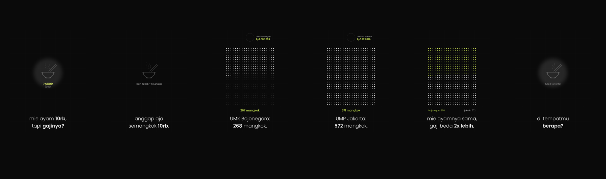

# gilvy

gilvy turns a YAML episode into a faceless 9:16 explainer: motion graphics, a caption, and a voice-over. The look is locked (1080×1920, 60 fps, 2× supersampling, Poppins, one green idea per screen) so an agent can change the script without changing the picture.

Coding agents (opencode, Claude Code, Cursor) get a CLI and an MCP server. The production recipe is `skills/gilvy/SKILL.md`. Start with `AGENTS.md`.



## Install

ffmpeg is the only system dependency. Python packages are pinned.

```bash
python -m venv .venv
source .venv/bin/activate
pip install -e ".[dev]"
```

Poppins (SIL Open Font License) ships in `src/gilvy/fonts` with its `OFL.txt`. The rest of the project is MIT.

## Make a video

```bash
gilvy preview examples/ep01-mie-ayam.yaml --tts fixture
gilvy render examples/ep01-mie-ayam.yaml
gilvy qc out/ep01-mie-ayam.mp4
```

`--tts edge` (the default) calls edge-tts. `--tts fixture` is an offline tone so you can check layout without the network. Publish with the real voice.

| Command | What it does |
|---|---|
| `gilvy new ep02` | Scaffold `ep02/ep02.yaml` and a custom-scene stub |
| `gilvy preview ep.yaml` | One still per scene at 80%, plus a contact sheet |
| `gilvy render ep.yaml` | Voice, pictures, music bed, AAC mux. Then QC |
| `gilvy qc out.mp4` | Green ratio, silence gaps, blank and dark frames. Exit 1 on a violation |
| `gilvy mcp` | MCP server on stdio |

A scene is a type from the library (`bowl_hook`, `coin_drop`, `ring_drain`, `compare`, `highlight`, `bowl_cta`, `timeline`, `checklist`, `jars`, `converge`, `coin_cta`) or `python: file.py:draw` when the library cannot say it. Examples:

- `examples/ep01-mie-ayam.yaml` — Indonesian, `id-ID-ArdiNeural`
- `examples/day30-january.yaml` — English, no green
- `examples/custom.yaml` — the escape hatch

Voice, language, output path, palette, and font directory are fields on the episode. Nothing is monkeypatched.

## Color

Green is one number: the money figure, or a count and the counter that repeats it. Rings, bowls, tracks, and captions stay white. Setup and the CTA may use no green at all. Measurements and the full rule are in `docs/color-rule.md`.

`gilvy qc` fails when a frame is too green, a focus scene never went green, a caption went green, the voice leaves a hole longer than two seconds, or a content frame has no drawing.

## Docker

```bash
docker build -t gilvy .
docker run --rm -v "$PWD:/work" -w /work gilvy render examples/ep01-mie-ayam.yaml --out out/ep01.mp4
docker run --rm -v "$PWD:/work" -w /work gilvy qc out/ep01.mp4
```

The image already contains the examples at `/opt/gilvy/examples`. CI renders `ep01-mie-ayam.yaml` there with `--tts fixture` and requires QC to pass. Fixture keeps the job deterministic; a published video uses edge-tts.

## Agents

`opencode.json` registers the MCP server as `gilvy mcp`. Claude Code and Cursor samples are in `examples/mcp/`. Install the package in the same environment the agent uses, then ask it to preview before it renders.

## Tests

```bash
pytest -q
```

Frame tests redraw the original episodes and compare bytes with the vendored renderer in `tests/fixtures`. A drift in easing, glow, captions, or a scene type fails that compare.

## Bahasa Indonesia

gilvy membuat video penjelasan 9:16 tanpa wajah: gambar gerak, teks, dan sulih suara. Naskahnya satu berkas YAML.

Contoh bahasa Indonesia: `examples/ep01-mie-ayam.yaml`, suara `id-ID-ArdiNeural`.

Urutannya: tulis voice-over dulu, pilih jenis adegan, `gilvy preview`, `gilvy render`, lalu `gilvy qc`. Hijau hanya untuk satu angka di layar. Caption tetap putih. Kalau QC gagal, perbaiki YAML-nya. Jangan mengubah mesin gambarnya.

```bash
gilvy render examples/ep01-mie-ayam.yaml
gilvy qc out/ep01-mie-ayam.mp4
```
