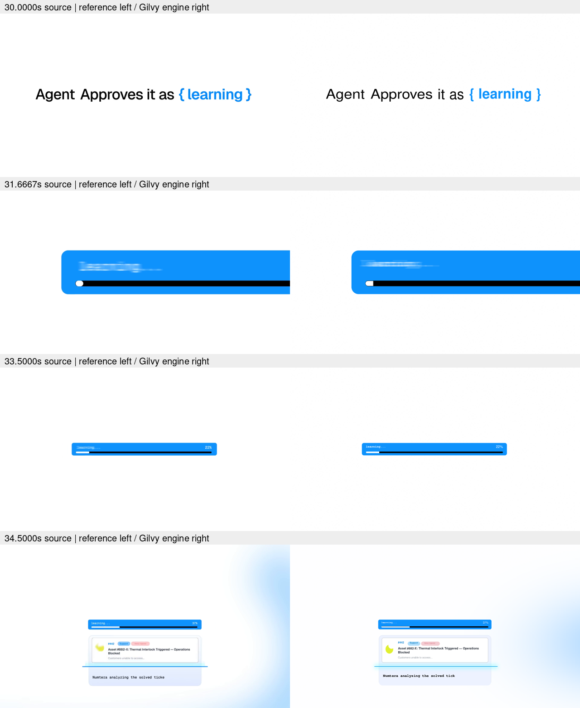

# Product primitives: engine proof and remaining gaps

The product compositor now exposes reusable typography, masks, counters,
M/L/Q/C/Z paths, ellipses, pivots, independent axis scale, cubic Bezier easing,
directional blur, per-layer temporal sampling and animated Gaussian light
fields. Preset inbox/menu/panel components remain optional. The explainer
renderer and its style constraints are not changed.

The AI authors the composition, functional narrative and object choreography.
The engine executes that authored specification; it does not automatically
infer good design from a video. `PRODUCT_MOTION.md` defines an evidence and
review contract for agents, and the skill routes explicit SaaS work before
the locked explainer instructions.

## Engine proof

`examples/product/study/build.py` builds the source 30–35s Numtera study and
an unrelated fictional metric-card exercise. Both render through ProductFilm
and render_product. The earlier standalone Pillow reconstruction is not used
as artwork or as a renderer for these films. Font files and the source video
are external inputs; the reproducible builder and measurements are committed.

Paired sample times are source 30.0000, 31.6667, 33.5000 and 34.5000 seconds.
The comparison uses source time minus 30 as engine time. The reference shot
cuts from words to a large bar at 31.4s; the engine preserves that boundary.
Individual words have tracks. The bar contains independent fill and counter
layers. The card's animated clipping reveals contents without stretching text.

## Concrete creative review

The weakest correspondence remains the high-speed label blur: spatial kernel
and chosen font are approximations, not a recovered shutter. Paired frames
also show different font details, background-field shape and yellow asset.
The carrier opening curve is hand-estimated. Revisions reduced the background
field's intrusion into the center, corrected the counter's sampled interpolation,
and retained ambiguity explicitly in imported-track provenance. The source
continues beyond this scoped proof; no whole-film fidelity is claimed.

The metric exercise verifies the tools can produce a distinct dark composition,
a large counter, mask opening and curved stroke without a new application
template. Its fictional figures are labelled as sample data. It is a capability
exercise, not evidence of an approved SaaS visual standard.

Native stills and paired timestamped samples were inspected. Normal-speed
human playback review remains a review step; do not represent sampled images
or technical checks as proof of perceived rhythm or final visual approval.

## Technical validation

Behavioral tests check stable child geometry through a group mask, cached-plane
integrity, baseline/reveal alignment, missing font errors, explicit counter
formatting, independent numeric tracks, Bezier timing, pivots, animated lights,
directional spread without a black alpha halo, object-local shutter sampling,
path reveals and quality-gated imports through Python and MCP. Existing product
and explainer tests remain in the full suite.

Each built proof has 150 frames, 30fps and five seconds, with silent H.264 video.
The study is 1920×1080 and metric exercise 1280×720. Full-decode checks and
exact frame counts are technical integrity evidence only. Validation details
for the change are also recorded in the pull request.

## Open work

- Generic object tracking, OCR, occlusion handling and independent extraction
  quality estimation are not implemented. The importer consumes reviewed data.
- No automatic font/curve/shutter recovery, reference-to-scene synthesis,
  sound-effect identification or beat synchronization is claimed.
- Masks are rounded rectangles, not arbitrary animated vector mattes. Paths
  flatten curves; fills do not support holes, boolean operations or SVG import.
- Light position/radius/RGB animate; the base color and light alpha remain static.
- Directional blur is a spatial approximation; temporal sampling is CPU-bound
  and may mix states at a cut. Neither setting automatically chooses itself.
- More primitives do not guarantee design judgment. Inspect short proofs and
  revise before extending a film; an integrity pass is not creative approval.
